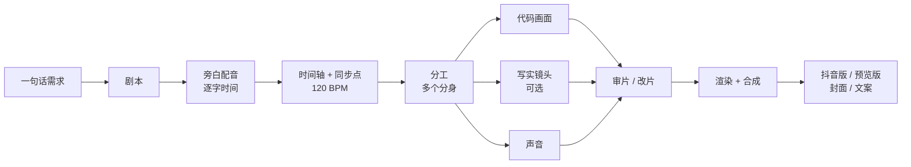

# 06 制作流程：从一句话到成片



每个阶段下面写了：**AI 在干什么**、**你要看什么**、**你可能要说什么**。

---

## ① 剧本

- **AI 在干什么：** 按幕写画面、旁白、声音。每一幕都是整数小节（120 BPM，1 小节 = 2 秒）。开头给你几个钩子选；每句都过「字面属实」清单。
- **你要看：** `剧本.md`。念一遍旁白，看顺不顺、意不意外、有没有经不起追问的话。
- **你可能说：**「开头换第 2 个」「这句太长」「这个说法不对吧，你查一下」。

## ② 旁白配音 + 时间轴

- **AI 在干什么：**
  - 用 TTS 逐句合成，拿到每个字的时间；
  - 按节拍排进小节；
  - 生成全片唯一的一份**同步点**：哪一拍盖章、哪一拍跳档、哪一拍白屏。之后画面、音乐、写实镜头全部从这里读时间。
- **你要看：** 一段只有旁白的音频，听语气、停顿、读音。它可以用语音识别自己检查多音字。
- **你可能说：**「声音不好听，换一个」「语速慢一点」「这个字读错了」。

## ③ 分工

- **AI 在干什么：** 写一份所有分身共用的**制作说明**（`PRODUCTION.md`）：
  - 时间轴表；
  - 共用模块的接口；
  - 谁负责哪些文件；
  - 规矩：只改自己的文件、只出静帧、显卡只给一个分身用、屏幕上的字必须属实。
  写好后按段落开分身，同时开工。
- **你要看：** 一张分工表，知道谁在做什么就行。
- **你可能说：**「开 7 个」「先做开头给我看」。

## ④ 代码画面

- **AI 在干什么：** 在浏览器里用代码一帧一帧画：
  - 数字网格、仪表、文字动画、粒子、光效、胶片质感……
  - 每一帧只由时间决定，所以任何一段都能单独重渲；
  - 每个分身交活时附缩略图拼图和关键帧大图。
- **你要看：** 拼图。只看「好不好看、对不对味」，不用看代码。
- **你可能说：**「这个字太小」「这里再炸一点」「这段太乱了」。

## ⑤ 写实镜头（档位 ②③，可选）

- **AI 在干什么：**
  - 写视频模型提示词，出写实镜头；
  - 每条看拼图决定用不用；
  - 跨界转场用**首尾帧**：第一帧是代码画面，最后一帧是写实镜头第一帧，中间让模型自己接。
  - 详见 `08_视频模型.md`。
- **你要看：** 每条镜头的拼图、转场前后对比、十几秒的预览。
- **你可能说：**「这条闪电不够猛」「升级 2K」。

## ⑥ 声音

- **AI 在干什么：** 代码合成的电子乐 + AI 配乐（可选）+ 音效 + 写实镜头自带的环境声，然后混音。
  - 每个画面事件（盖章、跳档、碎裂、心跳）都对上声音。
  - 响度推到 −12 LUFS。
  - 详见 `09_声音.md`。
- **你要听：** 它发给你的混音，最好戴耳机。它会列出几处让你重点听的地方。
- **你可能说：**「交响乐不够真」「再响一点」「这里太吵了」。

## ⑦ 审片、改片

- **AI 在干什么：** 抽 15–20 帧拼图逐段检查，发你带声音的预览。你提意见，它逐条落到具体的时间和数值上。
- **你要看：** 手机上的预览版，就像观众那样看。
- **你可能说：** 见 `05_跟AI沟通.md` 第 3 节。

## ⑧ 渲染、交付

- **AI 在干什么：**
  - 渲染：1080p60 全片无声画面 + 混音合成；只改声音时不重渲画面。
  - 编码：抖音上传版（27 Mbps）+ 手机预览版（720p，≤ 28 MB）。
  - 封面：横 4:3、竖 3:4。
  - 发布文案。
  - 详见 `10_导出与发布.md`。
- **你要做：** 上传抖音，勾「内容由 AI 生成」。

---

## 文件夹长什么样（AI 会建好）

```
projects/你的片名/
├── 剧本.md
├── PRODUCTION.md      # 制作说明（分身共用）
├── STATUS.json        # 进度（飞书简报读它）
├── .env               # 密钥（不上传）
├── app/               # 渲染工程：引擎 + 每段的场景代码
├── tools/             # 配音、时间轴、同步点、混音脚本
├── data/              # 旁白逐字时间、同步点、音频特征
├── audio/             # 配音、配乐、音效、混音
├── clips_src/         # 写实镜头原片
└── out/               # 成片、预览、封面、审片图
```
